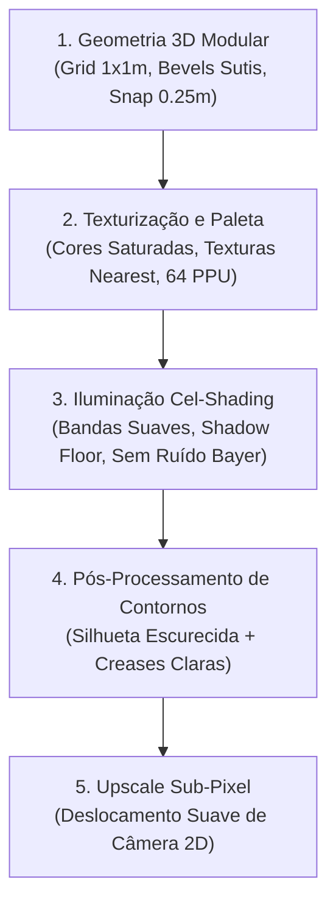

# EDEN PROJECT — ART BIBLE: HD PIXEL ART 3D
**Versão:** 1.0.0-Master | **Status:** Aprovado | **Data:** Novembro de 2026  
**Estilo Visual:** HD Pixel Art 3D Ortográfico Estilizado (David Holland Architecture)

---

## 1. VISÃO ARTÍSTICA E PRINCÍPIOS FUNDAMENTAIS

O estilo de arte do **Eden Project** combina a nostalgia estética da era de ouro dos RPGs em pixel art com o poder cinemático, volumétrico e de iluminação da renderização tridimensional moderna. Não se trata de uma cena 3D com um filtro de blur ou pixelização genérico por cima, mas de uma **renderização geométrica matematicamente travada na grade de texels no espaço de visão**.

---

## 2. MÉTRICAS E DENSIDADE DE PIXELS (PPU)

- **Densidade Canônica (PPU):** Exatamente **64 pixels por unidade métrica (1.0 m)**.
- **Tamanhos de Câmera Permitidos:** Exclusivamente potências de 2:
  - `Size 5.0`: Close-up dramático / visualização de combate íntimo.
  - `Size 10.0`: Zoom padrão canônico de exploração e jogabilidade.
  - `Size 20.0`: Visão tática de área / construção de acampamento.
  - `Size 40.0`: Visão panorâmica / mapa regional macro.
  > [!IMPORTANT]
  > Jamais utilize valores fracionários de zoom (como 12.5 ou 18.0). Qualquer valor que não seja potência de 2 quebra a amostragem 1:1 dos texels e introduz artefatos de "shimmering" e pixels distorcidos.

---

## 3. MODELAGEM 3D E MODULARIDADE DE CENÁRIOS

1. **Grade Métrica do Mundo:**
   - Blocos de terreno padrão: $1.0 \times 1.0 \times 1.0\text{ m}$.
   - Degraus e taludes verticais: Snap obrigatório a cada $0.25\text{ m}$.
2. **Topologia e Bevels:**
   - Evitar quinas 100% afiadas de 90° em objetos feitos pelo homem ou rochas proeminentes; chanfros sutis (*bevel*) de 1 a 2 cm capturam os reflexos de luz e os highlights do shader de contorno.
   - Malhas de vegetação (folhagens de árvores e arbustos) devem usar formas esferoidais e estilizadas com normais suavizadas (*weighted normals*) para garantir transições tonais limpas.
3. **Escala Humana de Referência:**
   - Altura do personagem adulto: $1.75\text{ m}$ a $1.85\text{ m}$.
   - Portas e passagens de palafitas: $2.25\text{ m}$ de altura por $1.25\text{ m}$ de largura.

---

## 4. PALETAS CROMÁTICAS ATMOSFÉRICAS EQUATORIAIS

As tonalidades de luz solar e ambiente mudam dinamicamente ao longo das 24 horas simuladas para transmitir o calor e a umidade característicos da Floresta Amazônica:

| Horário Simulada | Fase do Dia | Cor da Luz Direta (Sol) | Cor do Céu (Background) | Luz Ambiente (WorldEnvironment) |
|---|---|---|---|---|
| **05h00 - 06h30** | Alvorada | Dourado Alaranjado `#FFB86B` | Rosa/Terracota `#B87066` | Malva Quente `#735266` ($E=0.55$) |
| **07h00 - 11h00** | Manhã | Amarelo Solar Suave `#FFF5D1` | Azul Celeste Tropical `#3D6C9E` | Violeta Diurno `#666180` ($E=0.65$) |
| **11h00 - 14h00** | Meio-dia (Zênite) | Branco Solar Vivo `#FFFCE0` | Azul Profundo `#3D6C9E` | Neutro Claro `#666180` ($E=0.65$) |
| **16h30 - 18h30** | Crepúsculo | Âmbar Profundo `#FF8540` | Laranja Crepúsculo `#CC5C33` | Roxo Púrpura `#754759` ($E=0.50$) |
| **19h00 - 04h30** | Noite | *Desligada* ($E=0.0$) | Azul Marinho Noturno `#0F1429` | Azul Noite Profundo `#293359` ($E=0.42$) |

---

## 5. DIRETRIZ MANDATÓRIA: ROTAÇÃO 180° HORIZONTAL (3D TURNAROUND)

> [!WARNING]
> Em jogos com assimetria de equipamentos (ex: arma na mão direita, tocha ou escudo na mão esquerda), **NUNCA execute um espelhamento horizontal 2D simples (`flip_h`)**. O espelhamento 2D troca erroneamente a lateralidade dos membros e quebra a consistência do modelo.

Ao gerar ou renderizar sprites de personagens virados para a esquerda/direita oposta:
1. **Assimetria Física Verdadeira:**
   - O objeto na mão dominante (direita) permanece fisicamente na mão direita. Ao virar de costas para a câmera ou para a esquerda, o braço direito fica no **plano de fundo (afastado da câmera)**.
   - O objeto na mão secundária (esquerda) permanece fisicamente na mão esquerda, posicionando-se no **primeiro plano (mais próximo da câmera)**.
2. **Oclusão Física de Profundidade (*Depth Occlusion*):**
   - Se uma lança ou espada cruzar atrás do tronco ou da cabeça do personagem quando visto do outro ângulo, ela deve ser naturalmente encoberta pela anatomia. Jamais contorça braços ou ombros de forma antinatural apenas para forçar a visibilidade da arma.
3. **Mapeamento Cinemático Esquelético:**
   - Identifique e preserve a curvatura da coluna (*Spine*), inclinação do quadril e ângulos de cotovelos e joelhos antes de projetar a visão reversa.
4. **Calibração Biométrica e Alinhamento de Solo:**
   - A altura delimitadora ($H_{\text{orig}}$) do sprite gerado deve ser exatamente idêntica à do sprite de referência.
   - A base dos pés deve ancorar rigorosamente na mesma linha de solo do canvas ($Y = Y_{\text{solo}}$).

---

## 6. DIRETRIZES DE SHADERS E TEXTURIZAÇÃO

- **Filtragem de Texturas:** Todas as texturas albedo e máscaras devem usar amostragem `filter_nearest` para preservar o corte limpo dos pixels.
- **Top Surface Blending:** Blocos de terreno que recebem grama ou musgo no topo utilizam projeção triplanar com corte baseado no vetor normal vertical ($v\_world\_normal.y > 0.55$).
- **Transparência de Água:** O shader de água (`pixel_water.gdshader`) deve manter a visibilidade do leito e dos peixes submersos, com atenuação de profundidade calculada via `depth_texture`.
