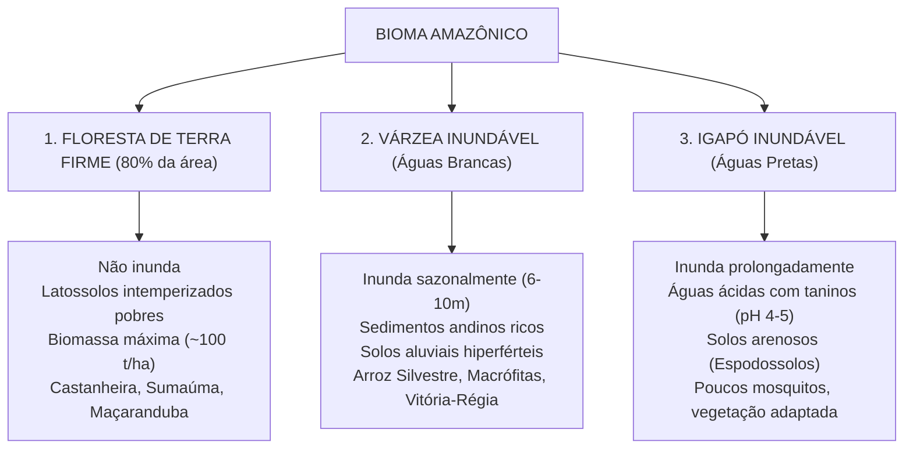
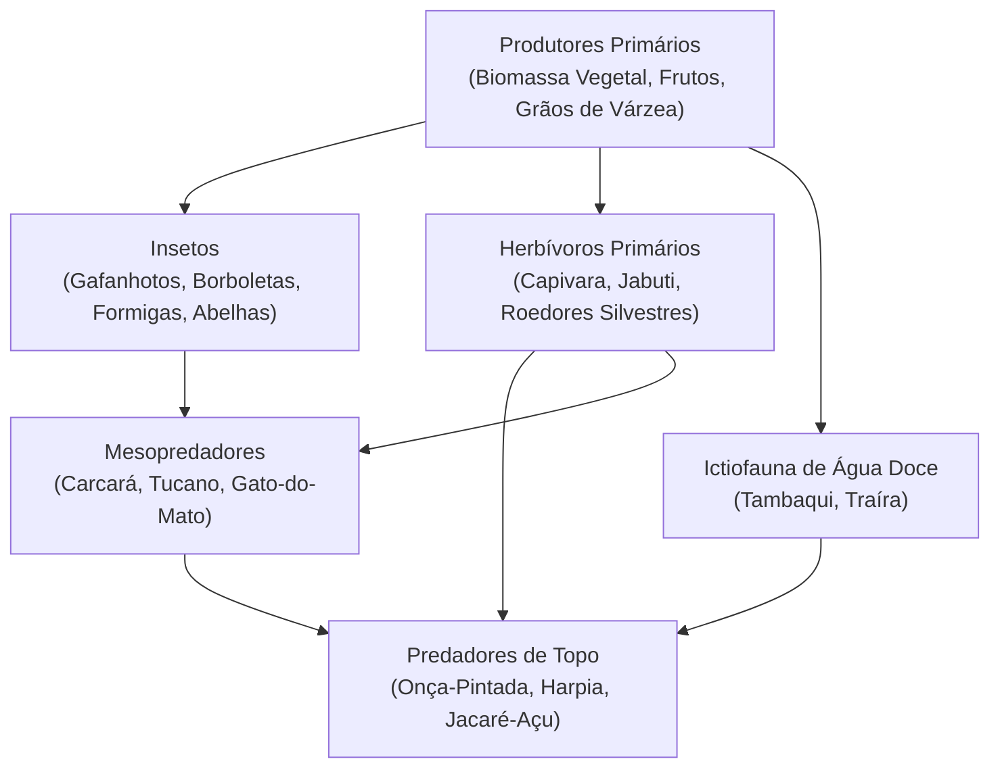

# EDEN PROJECT — BIOME BIBLE: FLORESTA TROPICAL ÚMIDA AMAZÔNICA
**Versão:** 1.0.0-Master | **Status:** Aprovado | **Data:** Novembro de 2026  
**Referência Científica:** Bases de Dados PanTHERIA, TRY Plant Database, Add-my-Pet e INPA (Instituto Nacional de Pesquisas da Amazônia)

---

## 1. CARACTERIZAÇÃO FITOFISIONÔMICA E CLIMÁTICA

A Bacia Amazônica abriga o maior ecossistema de floresta tropical contínua da Terra. No Eden Project, o ambiente é governado por três zonas geomorfológicas e ecológicas distintas:

---

## 2. REGIME HIDROLÓGICO E TIPOLOGIA DE ÁGUAS

### 2.1 As Três Águas Amazônicas
1. **Rios de Águas Brancas / Barrentas (ex: Rio Solimões, Madeira):**
   - **Origem:** Degradação geológica da Cordilheira dos Andes.
   - **Carga de Sedimentos:** Altíssima concentração de argila e siltes em suspensão ($> 100\text{ mg/L}$).
   - **Química:** pH neutro a ligeiramente básico ($6.5\text{ a }7.2$), alta condutividade elétrica.
   - **Efeito no Jogo:** Deposita lodo fértil a cada ciclo de enchente, acelerando o crescimento vegetal de gramíneas C4 e culturas agrícolas.
2. **Rios de Águas Pretas (ex: Rio Negro):**
   - **Origem:** Escoamento sobre planícies arenosas antigas com decomposição incompleta de matéria orgânica.
   - **Carga de Sedimentos:** Quase nula; transparência avermelhada/âmbar por ácidos húmicos e fúlvicos.
   - **Química:** Altamente ácida ($pH\ 3.8\text{ a }4.8$), baixíssima concentração de sais minerais.
   - **Efeito no Jogo:** Água estéril para larvas de mosquito (menor risco de picadas/doenças), porém solos de igapó adjacentes são extremamente inférteis.
3. **Rios de Águas Claras (ex: Rio Tapajós, Xingu):**
   - **Origem:** Escudos cristalinos estáveis do Brasil Central e Guianas.
   - **Química:** pH intermediário ($5.5\text{ a }6.8$), excelente penetração de luz no leito.

### 2.2 O Fenômeno do Encontro das Águas
Quando o Rio Negro (água preta, 28°C, velocidade ~2 km/h) e o Rio Solimões (água barrenta, 22°C, velocidade ~5 km/h) confluem, as massas de água fluem lado a lado sem se misturarem por mais de 6 km devido às diferenças de densidade, temperatura e velocidade de escoamento. Esse fenômeno é reproduzido proceduralmente nas cenas de validação hidrográfica do projeto (`modular_hydrology_16x16_geometry.gd`).

---

## 3. CATÁLOGO BOTÂNICO (FLORA NATIVA CALIBRADA)

| Espécie / Nome Comum | Nome Científico | Estrato | Zona Ecológica | Função Ecológica e Recursos |
|---|---|---|---|---|
| **Castanheira-do-Pará** | *Bertholletia excelsa* | Emergente ($45\text{ m}$) | Terra Firme | Madeira de lei densa, ouriços com sementes calóricas ricas em selênio e lipídios. |
| **Sumaúma** | *Ceiba pentandra* | Emergente ($50\text{ m}$) | Várzea / Terra Firme | Raízes tabulares gigantescas (sapopembas), abrigo de fauna, paina impermeável. |
| **Açaizeiro** | *Euterpe oleracea* | Sub-bosque ($15\text{ m}$) | Várzea e Igarapés | Cachos de açaí (altíssimo valor energético para sobrevivência), palmito e estirpes para construção. |
| **Vitória-régia** | *Victoria amazonica* | Aquático | Lagos e Baías de Várzea | Folhas flutuantes com até $2.5\text{ m}$ de diâmetro, flores termogênicas, sementes comestíveis. |
| **Arroz Silvestre** | *Oryza glumaepatula* | Macrófita ($1.5\text{ m}$) | Margens de Várzea | Cereal selvagem consumido por aves, roedores e peixes herbívoros (Tambaqui). |
| **Seringueira** | *Hevea brasiliensis* | Dossel ($30\text{ m}$) | Terra Firme | Extração de látex natural para confecção de recipientes elásticos e impermeabilização. |

---

## 4. CATÁLOGO ZOOLÓGICO E TEIA TRÓFICA (FAUNA SIMULADA)

Os animais operam em agentes autônomos orientados a dados (`SpeciesCatalog.cs` e `FaunaAgents.cs`), calibrados com equações alométricas da literatura zoológica:

### 4.1 Guildas e Parâmetros Fisiológicos

#### 1. Onça-Pintada (*Panthera onca*) — Predador de Topo
- **Massa Corporal:** $95\text{ kg}$ (macho adulto).
- **Taxa Metabólica Basal (BMR):** $\approx 115\text{ W}$ (Lei de Kleiber).
- **Alvos Preferenciais:** Capivara, Jacaré juvenil, Anta.
- **Comportamento:** Caça solitária crepuscular/noturna por emboscada e mordida craniana capaz de perfurar cascos duros de jabuti.

#### 2. Capivara (*Hydrochoerus hydrochaeris*) — Maior Roedor do Planeta
- **Massa Corporal:** $55\text{ kg}$.
- **Hábito:** Semi-aquático, gregário (grupos de 10 a 20 indivíduos).
- **Alimentação:** Pastoreio de gramíneas de várzea (*Paspalum*, *Echinochloa*) e arroz silvestre.
- **Comportamento de Fuga:** Mergulho prolongado em rios e igarapés ao detectar predadores via olfato e audição.

#### 3. Harpia / Gavião-Real (*Harpia harpyja*) — Maior Rapina Neotropical
- **Envergadura:** Até $2.2\text{ m}$; garras com mais de $10\text{ cm}$.
- **Habitat:** Copa e árvores emergentes da Floresta de Terra Firme.
- **Presas:** Primatas, preguiças, tucanos e pequenos mamíferos terrestres capturados em voo ágil pelo dossel.

#### 4. Jacaré-Açu (*Melanosuchus niger*) — Gigante dos Rios Amazônicos
- **Comprimento:** $4.0\text{ a }5.5\text{ m}$; peso superior a $400\text{ kg}$.
- **Termorregulação:** Ectotérmico; necessita de banhos de sol matinais nas praias de areia da vazante para aquecer o corpo antes de caçar na água.

---

## 5. CICLAGEM DE NUTRIENTES E DECOMPOSIÇÃO

- **Serapilheira (*Litterfall*):** Na floresta de Terra Firme, a cada ano caem cerca de $10\text{ toneladas}$ de folhas, galhos e frutos por hectare.
- **Decomposição Rápida:** Devido à alta temperatura constante ($26\text{ a }30^\circ\text{C}$) e umidade elevada ($> 85\%$), a camada orgânica é reciclada por fungos micorrízicos e bactérias do solo em menos de 90 dias.
- **No SimCore:** A morte de qualquer agente biológico deposita unidades em `OrganicDetritus` no Chunk. Este valor fertiliza o solo, permitindo a regeneração acelerada de biomassa vegetal (`FloraAutomata.cs`).
