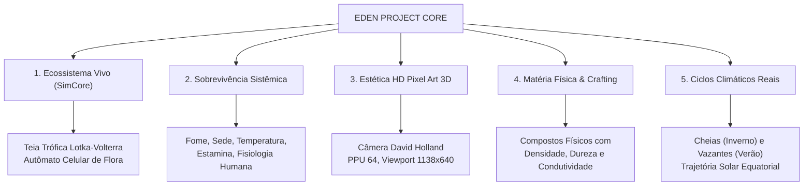
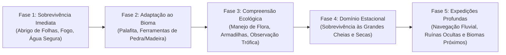

# EDEN PROJECT — GAME DESIGN DOCUMENT (GDD)
**Versão:** 1.0.0-Master | **Status:** Aprovado | **Data:** Novembro de 2026  
**Classificação:** Triple-A RPG Survival & Living Ecosystem Simulator  
**Engine:** Godot Engine 4.7 (Render & Client) + .NET 8 / C# SimCore (Simulação Científica)

---

## 1. VISÃO GERAL DO PROJETO

### 1.1 Resumo Executivo (Elevator Pitch)
**Eden Project** é um RPG de Sobrevivência Triple-A com perspectiva ortográfica estilizada em **HD Pixel Art 3D**, focado na representação física e biológica fiel dos ecossistemas reais do planeta Terra. O jogador é inserido em um mundo dinâmico e auto-sustentável onde a biosfera, a hidrologia e a termodinâmica operam continuamente sob modelos matemáticos rigorosos.

O primeiro ecossistema modelado é a **Floresta Tropical Úmida da Bacia Amazônica** — com suas florestas de Terra Firme, Várzeas inundáveis, florestas de Igapó e rios de águas negras, claras e barrentas.

---

## 2. PILARES FUNDAMENTAIS DE DESIGN

### Pilar 1: Ecossistema Vivo e Autônomo (C# SimCore)
- O mundo não gira em torno do jogador; a floresta vive por si mesma.
- Populações de animais caçam, reproduzem-se, migram e morrem seguindo leis metabólicas de escala (Lei de Kleiber $BMR \propto M^{0.75}$) e dinâmica de predador-presa de Lotka-Volterra.
- A vegetação consome umidade, absorve calor, transpira água para a atmosfera e regenera biomassa via autômato celular espacial.

### Pilar 2: Sobrevivência Sistêmica e Realista
- Sem barras de "vida mágica" abstratas. Dano e fadiga são reflexos diretos de trauma físico, desidratação, insolação, hipotermia ou envenenamento.
- O jogador precisa de água potável (fervida ou filtrada), abrigo contra tempestades tropicais convectivas e manejo calórico adequado.

### Pilar 3: Estética Icônica "HD Pixel Art 3D"
- Geometria tridimensional completa (Godot 4.7) renderizada através de uma SubViewport travada em texels inteiros (David Holland Architecture).
- Cel shading customizado em degraus tonais suaves (`pixel_surface.gdshader`), eliminação total de ruído dither e sombras volumétricas calibradas para evitar *shadow acne*.
- Linhas de contorno pixel-perfect (`pixel_outline.gdshader`) moduladas por descontinuidade de profundidade e vetor normal.

### Pilar 4: Física da Matéria e Crafting Composto
- Cada recurso (madeira de maçaranduba, argila, látex de seringueira, pedra vulcânica, fibras de tucum) possui propriedades físicas definidas (massa, densidade, dureza Mohs, condutividade térmica, ponto de ignição).
- As ferramentas e construções herdam diretamente as propriedades dos materiais compostos combinados.

### Pilar 5: Ciclo Solar e Estacionalidade Equatorial
- Simulação de latitude equatorial (~0°), onde o dia e a noite duram rigorosamente 12 horas.
- O ano planetário de 365 dias é dividido nas duas grandes estações amazônicas:
  - **Inverno Amazônico (Cheias):** Dezembro a Maio. Chuvas diárias torrenciais, transbordamento das várzeas e subida do nível d'água em até 10 metros.
  - **Verão Amazônico (Vazante):** Junho a Novembro. Estiagem relativa, bancos de areia e praias fluviais expostas, calor extremo no solo.

---

## 3. MECÂNICAS CENTRAIS DO JOGADOR

### 3.1 Vitals e Fisiologia
| Estatística | Capacidade | Mecanismo de Decaimento / Efeito |
|---|---|---|
| **Saúde (HP)** | 100.0 | Não regenera passivamente sem nutrição; cai com trauma, quedas, sangramento e infecções. |
| **Estamina** | 100.0 | Consumida por corrida, escalada, natação contra correnteza e golpes; regeneração rápida em repouso. |
| **Nutrição (Calorias)** | 2500 kcal | Gasto contínuo baseado na taxa metabólica basal e esforço físico. |
| **Hidratação** | 3000 ml | Transpiração acelerada por calor ambiente úmido. Ingestão de água crua causa parasitoses. |
| **Temperatura Corporal** | 36.5 °C | Abaixo de 35°C = Hipotermia (chuvas frias noturnas); acima de 38.5°C = Choque térmico por insolação. |

### 3.2 Movimentação e Interação no Terreno
- **Navegação Ortográfica Modular:** Deslocamento em 8 direções na grade métrica de 1.0 × 1.0 m, com snap vertical de 0.25 m.
- **Vadeamento e Natação:** Em águas até 0.6 m de profundidade, a velocidade é reduzida pela viscosidade; acima de 1.0 m, o jogador nada, consumindo estamina conforme a correnteza fluvial.
- **Coleta Baseada em Ferramentas:** Corte de madeira viva exige machados afiados; árvores mortas e galhos caídos podem ser recolhidos manualmente.

### 3.3 Construção e Palafitas
- O jogador deve construir abrigos adaptados ao pulso de inundação das águas.
- Estruturas no chão da várzea são destruídas ou submersas durante as cheias de inverno. A arquitetura correta exige **palafitas sobre estacas de madeira de lei** e telhados inclinados cobertos com palha de palmeira impermeável.

---

## 4. O BIOMA: FLORESTA TROPICAL ÚMIDA AMAZÔNICA

### 4.1 Estratificação Vertical da Vegetação
1. **Dossel Emergente (40 - 60 m):** Castanheira-do-Pará (*Bertholletia excelsa*) e Sumaúma (*Ceiba pentandra*). Ninhos de Harpias, alta insolação e vento.
2. **Dossel Médio (20 - 35 m):** Árvores de copa contínua, bromélias epífitas, cipós e habitat de tucanos e primatas.
3. **Sub-bosque (2 - 10 m):** Açaizeiros (*Euterpe oleracea*), palmeiras de buriti, arbustos ombrófilos tolerantes à sombra densa.
4. **Chão da Floresta (0 - 2 m):** Camada de serapilheira, fungos decompositores, gramíneas de várzea (*Oryza glumaepatula*) e macrófitas aquáticas (*Vitória-régia*).

### 4.2 Classificação das Águas Fluviais
- **Águas Brancas/Barrentas (ex: Rio Solimões):** Ricas em sedimentos minerais andinos, pH neutro (~6.5 a 7.0), solo fértil de várzea com altíssima taxa de crescimento vegetal.
- **Águas Pretas (ex: Rio Negro):** Pobres em sedimentos, ricas em ácidos húmicos e taninos dissolvidos de folhas, pH ácido (~4.0 a 5.0), florestas inundadas de Igapó, ausência quase total de mosquitos.
- **Águas Claras (ex: Rio Tapajós):** Baixa carga de sedimentos em suspensão, alta transparência e leito rochoso/arenoso.

---

## 5. LOOP DE JOGO E PROGRESSÃO

1. **Amanhecer (06h - 09h):** Temperatura amena (24°C), luz solar suave. Período ideal para caça, coleta e deslocamento terrestre longo.
2. **Meio-dia (11h - 14h):** Sol a pino no zênite (32°C a 36°C), umidade relativa em 85%. Risco severo de exaustão térmica; animais recolhem-se à sombra densa.
3. **Tarde Convectiva (15h - 17h):** Formação de nuvens Cumulonimbus. Chuvas torrenciais diárias de convecção, relâmpagos e resfriamento rápido.
4. **Crepúsculo (18h - 19h):** Transição rápida de luz. Emergência de predadores crepusculares e noturnos (Onça-pintada, Jacaré-açu, morcegos).
5. **Noite (19h - 05h):** Escuridão na mata densa, necessidade absoluta de tochas ou fogueiras em abrigos elevados para afastar predadores e insetos.

---

## 6. INTERFACE DE USUÁRIO (HUD)

- **Minimalista e Orgânica:**
  - Vitals integrados no canto inferior esquerdo (indicadores circulares de Saúde, Estamina, Hidratação, Nutrição e Temperatura).
  - Relógio Solar e Calendário Equatorial no canto superior direito: Hora formatada, dia do ano (1 a 365) e estação ativa (*"Inverno Amazônico - Cheias"* vs *"Verão Amazônico - Vazante"*).
  - Hotbar de 8 slots rápidos para ferramentas na base inferior da tela.
  - Tela de Inventário em grade com peso por massa real (kg) e durabilidade mecânica de itens.
