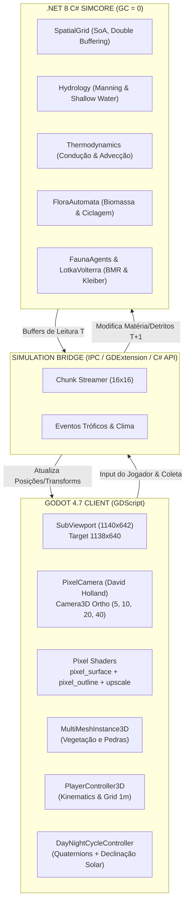

# EDEN PROJECT — TECHNICAL DESIGN DOCUMENT (TDD)
**Versão:** 1.0.0-Master | **Status:** Aprovado | **Data:** Novembro de 2026  
**Stack Principal:** Godot Engine 4.7 Forward+ / Compatibility + .NET 8 (C# SimCore)

---

## 1. VISÃO TÉCNICA E ARQUITETURA DE SISTEMAS

O Eden Project opera sob uma **Arquitetura Dual Desacoplada**:
1. **Client & Renderer (Godot 4.7 GDScript):** Responsável pela renderização estilizada em HD Pixel Art 3D, áudio espacial, interpolação cinemática de nós, câmera ortográfica pixel-perfect e UI/HUD.
2. **Simulation Core / SimCore (.NET 8 C#):** Engine autônomo de física térmica, hidrodinâmica de bacias fluviais, autômato celular de biomassa vegetal e teias ecológicas tróficas (Lotka-Volterra).



---

## 2. PIPELINE DE RENDERIZAÇÃO: DAVID HOLLAND PIXEL-PERFECT

### 2.1 Resolução Canônica e Viewport
- **Resolução Nativa Interna:** $1138 \times 640$ pixels.
- **Tamanho do SubViewport:** $1140 \times 642$ pixels (adiciona uma margem de exatamente $+2\text{ px}$ para suportar o deslocamento fracionário de sub-pixel sem cortar bordas na tela).
- **Pixel Density (PPU):** Exatamente **64 pixels por unidade métrica (1.0 m)**.
- **Tamanhos Ortográficos de Câmera Permitidos:** **Exclusivamente potências de 2 (5.0, 10.0, 20.0, 40.0)**. Valores fracionários intermediários são terminantemente proibidos, pois quebram o alinhamento da grade de texels.

### 2.2 Algoritmo de Compensação Sub-Pixel (`pixel_camera.gd`)
```gdscript
# 1. Converte posição do alvo para o espaço alinhado à rotação da câmera
var desired_pos: Vector3 = parent_node.global_position
var cam_basis: Basis = global_transform.basis
var view_space_pos: Vector3 = desired_pos * cam_basis

# 2. Faz o Snap na grade de texels (espaço de visão)
_texel_size = size / float(target_resolution.y)
var snapped_view_pos: Vector3 = view_space_pos
snapped_view_pos.x = round(view_space_pos.x / _texel_size) * _texel_size
snapped_view_pos.y = round(view_space_pos.y / _texel_size) * _texel_size

# 3. Extrai o erro fracionário de sub-pixel (-0.5 a +0.5)
var subpixel_error: Vector2 = Vector2(
    (view_space_pos.x - snapped_view_pos.x) / _texel_size,
    (view_space_pos.y - snapped_view_pos.y) / _texel_size
)

# 4. Aplica posição travada na câmera e envia subpixel_error para o shader de upscale 2D
global_position = cam_basis * snapped_view_pos
mat.set_shader_parameter("cam_offset", subpixel_error)
```

---

## 3. ESPECIFICAÇÃO DE SHADERS CUSTOMIZADOS

### 3.1 `pixel_surface.gdshader` (Cel Shading e Solução de Sombras)
- **Problema Histórico Solucionado:** Quando o sol se aproxima do zênite (90°), superfícies horizontais e verticais sofriam oscilações no shadow map gerando "shadow acne" e faixas pretas sólidas.
- **Solução Arquitetural:** Separação estrita de dois canais matemáticos no bloco `light()`:
  1. **Canal de Luz Direta (Bandas Toon):** Calculado com $N \cdot L$ puramente geométrico (imutável por ruído de shadow map).
  2. **Canal de Sombra Projetada:** Processa o `ATTENUATION` através de `smoothstep(shadow_softness, 1.0 - shadow_softness, ATTENUATION)` e aplica um piso de iluminação (`shadow_floor = 0.35`).
  3. **Resultado:** As sombras projetadas nunca apagam a textura do terreno em preto puro e eliminam artefatos oscilatórios.

### 3.2 `pixel_outline.gdshader` (Contorno e Creases 3D)
- Desenha bordas de silhueta (escurecimento em descontinuidade de profundidade) e highlights de quina (descontinuidade de vetores normais).
- **Parâmetros Calibrados:**
  - `depth_threshold = 0.06`
  - `normal_threshold = 0.72` (valores inferiores a 0.50 causam contorno indevido em cada quina dos blocos modulares de terreno de 1m).
  - `shadow_darken = 0.55`
  - `highlight_brighten = 0.30`

---

## 4. ILUMINAÇÃO SOLAR EQUATORIAL E MATEMÁTICA DE QUATÉRNIONS

No arquivo `day_night_cycle_controller.gd`:
- A trajetória do Sol no Equador terrestre atinge ângulos retos (90°) ao meio-dia. Para evitar o travamento de eixos (*Gimbal Lock*) que ocorre ao usar rotações Euler (`Vector3`), a rotação do Sol é calculada exclusivamente via Quatérnions:
$$\mathbf{q}_{\text{sol}} = \mathbf{q}_x(\theta_{\text{hora}}) \times \mathbf{q}_z(\theta_{\text{offset}})$$
- $\theta_{\text{offset}} = 10.0^\circ + \delta_{\text{sazonal}} \times 0.35$ (onde $\delta_{\text{sazonal}} = 23.44^\circ \times \sin\left(\frac{\text{dia} - 80}{365} \times 2\pi\right)$).
- **Desligamento Noturno:** Quando $\sin(\theta) \le 0$, a luz direcional é marcada com `visible = false` e `light_energy = 0.0`, aliviando render passes desnecessários na GPU.

---

## 5. ARQUITETURA DO SIMCORE (C# .NET 8)

### 5.1 Estrutura de Chunks (Structure of Arrays - SoA)
- Cada Chunk espacial possui dimensão de $16 \times 16$ células métricas ($256\text{ células}$).
- Em vez de usar objetos individuais `Cell` (que fragmentariam a memória heap e causariam pressão no Garbage Collector), o Chunk aloca arrays contíguos primitivos:
  - `ushort[] MaterialId`
  - `float[] Temperature`
  - `float[] Moisture`
  - `float[] SurfaceWater`
  - `float[] SuspendedSediment`
  - `float[] WaterDischarge`
  - `float[] LakeWater`
  - `float[] OrganicDetritus`
  - `float[] Grains`
  - `float[] Elevation`
  - `float[] Biomass`
- **Double Buffering:** Cada array possui seu correspondente `Next*`. Durante o tick de simulação, as threads leem exclusivamente do buffer atual e escrevem no próximo buffer. Ao final do tick, os ponteiros são invertidos em $O(1)$ (`SwapBuffers()`), garantindo zero concorrência de escrita e zero Garbage Collection ($GC = 0$).

### 5.2 Escala de Tempo e Frequência de Ticks
- **Render Loop (Godot):** 60 FPS com interpolação de posições.
- **SimCore Physics & Hydrology Tick:** 20 Hz ($\Delta t = 0.05\text{ s}$).
- **Flora & Organic Decomposition Tick:** 1 Hz ($\Delta t = 1.0\text{ s}$).
- **Macro Climate & Convection Tick:** 0.1 Hz ($\Delta t = 10.0\text{ s}$).

---

## 6. DIRETRIZES DE CÓDIGO E CONVENÇÕES DE ENGENHARIA

1. **Tipagem Estática Obrigatória em GDScript:**
   - Todo script deve utilizar anotações explícitas de tipo em variáveis e retornos de função (`var x: float = 1.0`, `func _ready() -> void:`).
2. **Nomenclatura Canônica:**
   - Arquivos GDScript: `snake_case.gd`.
   - Classes e Nós Godot: `PascalCase`.
   - Variáveis e funções: `snake_case`.
   - Constantes: `UPPER_SNAKE_CASE`.
3. **Tratamento de Fim de Linha (CRLF no Windows):**
   - Todos os arquivos `.gd`, `.tscn` e `.gdshader` devem preservar a terminação de linha canônica do repositório para evitar conflitos desnecessários de Git.
